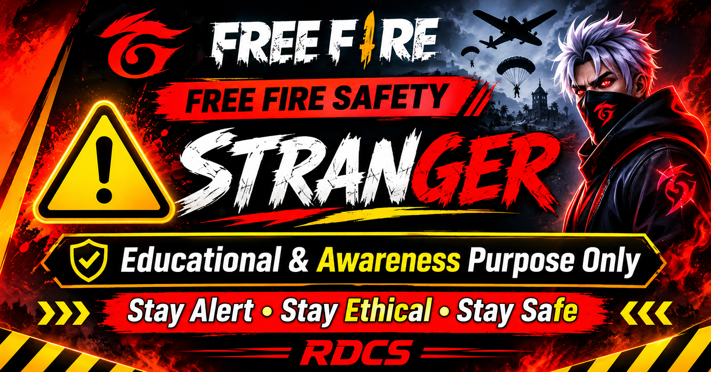

# FF_H4CK-V1

  
   
  <b>RDCS SOCIETY</b>

FF_H4CK – Coda Shop Security Awareness Demo

About This Project

FF_H4CK is an educational web-security awareness project featuring a simulated Coda Shop webpage.

The project illustrates how website design can be replicated in a controlled demonstration environment to help people understand website authenticity, online privacy, and account security.

Project Objectives

- Raise awareness about online security risks.
- Help users identify suspicious websites.
- Introduce students to web security concepts.
- Promote responsible cybersecurity education.
- Encourage safe browsing habits and account protection.

This project is designed for educational demonstrations and authorized testing in controlled environments.

Supported Platforms

- Termux (Android)
- Kali Linux

Installation

Step 1: Update packages

pkg update && pkg upgrade -y

Step 2: Install dependencies

pkg install python openssh git -y

Step 3: Clone the repository

git clone https://github.com/RDCD-SOCIETY/FF_H4CK-V1.git

Step 4: Navigate to the project directory

cd FF_H4CK-V1

Configuration

Configure the demonstration environment using test data and simulated accounts.

No real account credentials or personal information should be collected or transmitted.

Launch the Application

python FF_H.py

Select option "1" and press Enter.

The application will launch its demonstration interface and display a PUBLIC URL for authorized testing.

Disclaimer

FF_H4CK is an independent educational project intended to promote web-security awareness and responsible technology use.

Use this project only in controlled environments with appropriate authorization.

The project should not be used to collect personal information, access accounts, or interfere with third-party services.

Stay informed. Browse safely. Practice responsibly.

---

RDCS – Read Dragon Cyber Security
